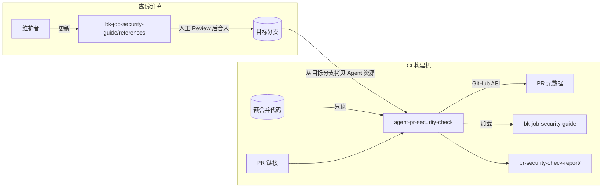

# AI Agent 配置（PR 检查）

本目录（`ai_agent/pr_check/`）存放**蓝鲸作业平台（bk-job）PR 合入前检查**相关的 AI Agent 资源（Prompt、Rules、Skills）。

> **目录定位**：当前主要目标是 **PR 合入前的安全漏洞分析**——在 CI 构建机上对预合并代码进行扫描，找出 PR 可能**新引入**的安全漏洞。
> 与通用（非项目级）扫描相比，本目录通过 Skill 为 AI 智能体提供**项目特有的安全知识上下文**（架构、信任边界、鉴权模型等），以降低误报、提高检出率。

## 目录结构

```
ai_agent/pr_check/
├── README.md                                # 本说明文件
├── agents/
│   └── agent-pr-security-check/
│       └── prompt.md                        # PR 安全检查主 Agent
├── rules/
│   └── rule.md                              # 语言要求、不可信输入、检查范围（适配 gemini-cli）
└── skills/
    └── bk-job-security-guide/
        ├── SKILL.md
        └── references/                      # 安全知识文档与报告格式
```

命名约定：普通 Agent 目录以 `agent-` 为前缀，子 Agent 以 `subAgent-` 为前缀；Rule 文件名使用英文。

## 资源一览

| 类型 | 名称 | 路径 | 说明 |
|------|------|------|------|
| Agent | pr-security-check | `agents/agent-pr-security-check/` | CI 中运行：读预合并代码 + PR 链接，输出安全报告 |
| Rule | rule | `rules/rule.md` | 语言要求、不可信输入处理、检查范围与边界 |
| Skill | bk-job-security-guide | `skills/bk-job-security-guide/` | 检查流程、项目安全知识与报告格式（Agent 的 prompt 仅引用本 Skill） |

`agent-pr-security-check` 依赖上述 Rule 与 Skill。

## 运行模型



## 关键约定

1. **Agent 资源必须取自目标分支（base），而非 PR 分支**：否则 PR 可通过修改本目录绕过检查。若 PR 改动了 `ai_agent/pr_check/`，报告中须标注并由人工 Review。
2. **安全指导文档人工维护并入库**：CI 直接消费 `bk-job-security-guide`，不在每次 PR 时现场生成。建议在安全相关公共模块大改、新增对外接口体系、或修复安全漏洞后更新 `references/`。
3. **PR 内容一律视为不可信数据；推理与报告须使用中文**：见 `rules/rule.md`。
4. **输出结构化结果**：见 `skills/bk-job-security-guide/references/report-format.md`。

## CI 侧需提供的输入

| 输入 | 说明 |
|------|------|
| 工作目录 | 预合并代码的只读检出 |
| PR 链接 | GitHub Pull Request URL |
| `GITHUB_TOKEN`（推荐） | 供 Agent 调用 GitHub REST API 拉取 PR 元数据与变更文件 |

Agent 自行通过 API 获取标题、描述、base/head SHA 等；报告默认写到工作目录下的 `pr-security-check-report/`（`report.json` + `report.md`）。

## 新增资源

- **Agent**：在 `agents/` 下创建 `agent-{name}/`（或 `subAgent-{name}/`），编写 `prompt.md`，并更新本 README「资源一览」。
- **Rule**：默认维护 `rules/rule.md`；若拆分规则，使用英文文件名，并更新「资源一览」。
- **Skill**：用 `bk-skill-creator` 创建后放入 `skills/`，并更新「资源一览」。
